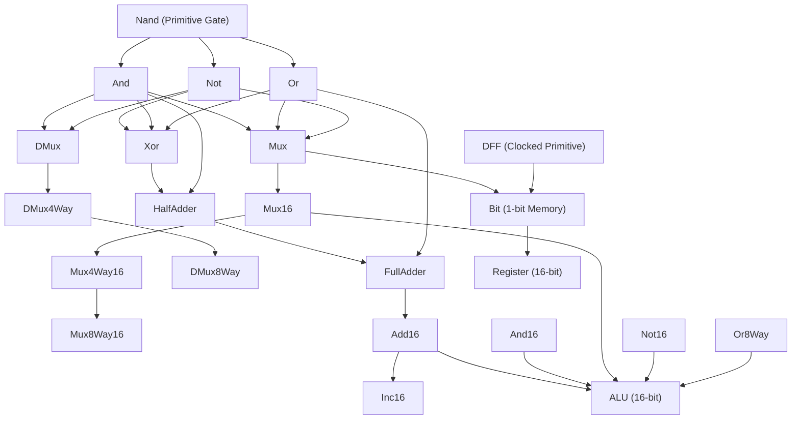

# NAND to Tetris: Hardware Construction & Theory

**Student**: Harsh Dev Jha  
**Student ID / Roll No**: `2501010168`  
**Coursework**: *Nand to Tetris - I.*

---

## 1. Overview

This repository contains the theory submissions and hardware description language (`.hdl`) implementations for the hardware construction layers of the Hack computer platform. Every digital component is designed from first principles, proceeding bottom-up from elementary logic gates through arithmetic building blocks to sequential memory components.



---

## 2. Repository Layout

```
NAND-to-Tetris_HarshDevJha_2501010168/
├── 1. Theory Assignments/
│   ├── Assignment_1-Harsh_Dev_Jha-2501010168-Nand_To_Tetris.pdf
│   └── Assignment2_Harsh_Dev_Jha-2501010168-N2T.pdf
├── 2. Lab Assignments/
│   ├── Add16.hdl
│   ├── ALU.hdl
│   ├── And.hdl
│   ├── And16.hdl
│   ├── Bit.hdl
│   ├── DMux.hdl
│   ├── DMux4Way.hdl
│   ├── DMux8Way.hdl
│   ├── FullAdder.hdl
│   ├── HalfAdder.hdl
│   ├── Inc16.hdl
│   ├── Mux.hdl
│   ├── Mux16.hdl
│   ├── Mux4Way16.hdl
│   ├── Mux8Way16.hdl
│   ├── Not.hdl
│   ├── Not16.hdl
│   ├── Or.hdl
│   ├── Or16.hdl
│   ├── Or8Way.hdl
│   ├── Register.hdl
│   └── Xor.hdl
└── readme.md
```

---

## 3. Hardware Implementation Matrix

All chips are defined using the Hack Hardware Description Language (`HDL`) and adhere strictly to the Hack hardware specification.

### 3.1 Project 1 — Boolean Logic

Fundamental combinatorial logic gates, multi-bit buses, and multi-way routing networks:

| Chip | Input Pins | Output Pins | Function / Internal Architecture |
| --- | --- | --- | --- |
| `Not.hdl` | `in` | `out` | Inverts single input bit via `Nand(a=in, b=in)`. |
| `And.hdl` | `a`, `b` | `out` | Boolean AND constructed via `Nand` followed by `Not`. |
| `Or.hdl` | `a`, `b` | `out` | Boolean OR via De Morgan's Law: `Nand(Not(a), Not(b))`. |
| `Xor.hdl` | `a`, `b` | `out` | Exclusive OR using `Or`, `Nand`, and `And`. |
| `Mux.hdl` | `a`, `b`, `sel` | `out` | 2-to-1 Multiplexor: outputs `a` if `sel=0`, else `b`. |
| `DMux.hdl` | `in`, `sel` | `a`, `b` | 1-to-2 Demultiplexor: channels `in` to `a` or `b` based on `sel`. |
| `Not16.hdl` | `in[16]` | `out[16]` | 16-bit wide bitwise negation. |
| `And16.hdl` | `a[16]`, `b[16]` | `out[16]` | 16-bit wide bitwise AND. |
| `Or16.hdl` | `a[16]`, `b[16]` | `out[16]` | 16-bit wide bitwise OR. |
| `Mux16.hdl` | `a[16]`, `b[16]`, `sel` | `out[16]` | 16-bit wide 2-to-1 bus multiplexor. |
| `Or8Way.hdl` | `in[8]` | `out` | 8-way logical OR: outputs 1 if any input bit is 1. |
| `Mux4Way16.hdl` | `a[16]`, `b[16]`, `c[16]`, `d[16]`, `sel[2]` | `out[16]` | 4-way 16-bit multiplexor combining three `Mux16` stages. |
| `Mux8Way16.hdl` | `a[16]`..`h[16]`, `sel[3]` | `out[16]` | 8-way 16-bit multiplexor cascading two `Mux4Way16` and one `Mux16`. |
| `DMux4Way.hdl` | `in`, `sel[2]` | `a`, `b`, `c`, `d` | 4-way single-bit demultiplexor tree using three `DMux` units. |
| `DMux8Way.hdl` | `in`, `sel[3]` | `a`..`h` | 8-way single-bit demultiplexor tree. |

### 3.2 Project 2 — Boolean Arithmetic

Arithmetic building blocks and the Hack Arithmetic Logic Unit (ALU):

| Chip | Input Pins | Output Pins | Function / Internal Architecture |
| --- | --- | --- | --- |
| `HalfAdder.hdl` | `a`, `b` | `sum`, `carry` | Adds 2 bits: `sum = Xor(a, b)`, `carry = And(a, b)`. |
| `FullAdder.hdl` | `a`, `b`, `c` | `sum`, `carry` | Adds 3 bits using two `HalfAdder` units and an `Or` gate. |
| `Add16.hdl` | `a[16]`, `b[16]` | `out[16]` | 16-bit ripple-carry adder composed of 16 cascaded full adders. |
| `Inc16.hdl` | `in[16]` | `out[16]` | 16-bit incrementer using `Add16(a=in, b[0]=true)`. |
| `ALU.hdl` | `x[16]`, `y[16]`, `zx`, `nx`, `zy`, `ny`, `f`, `no` | `out[16]`, `zr`, `ng` | 16-bit ALU computing arithmetic/logic functions conditioned on 6 control bits, plus zero (`zr`) and negative (`ng`) status flags. |

#### ALU Control Bit Truth Table

| zx | nx | zy | ny | f | no | Output Function |
| :---: | :---: | :---: | :---: | :---: | :---: | :--- |
| 1 | 0 | 1 | 0 | 1 | 0 | `0` |
| 1 | 1 | 1 | 1 | 1 | 1 | `1` |
| 1 | 1 | 1 | 0 | 1 | 0 | `-1` |
| 0 | 0 | 1 | 1 | 0 | 0 | `x` |
| 1 | 1 | 0 | 0 | 0 | 0 | `y` |
| 0 | 0 | 1 | 1 | 0 | 1 | `!x` |
| 1 | 1 | 0 | 0 | 0 | 1 | `!y` |
| 0 | 0 | 1 | 1 | 1 | 1 | `-x` |
| 1 | 1 | 0 | 0 | 1 | 1 | `-y` |
| 0 | 1 | 1 | 1 | 1 | 1 | `x + 1` |
| 1 | 1 | 0 | 1 | 1 | 1 | `y + 1` |
| 0 | 0 | 1 | 1 | 1 | 0 | `x - 1` |
| 1 | 1 | 0 | 0 | 1 | 0 | `y - 1` |
| 0 | 0 | 0 | 0 | 1 | 0 | `x + y` |
| 0 | 1 | 0 | 0 | 1 | 1 | `x - y` |
| 0 | 0 | 0 | 1 | 1 | 1 | `y - x` |
| 0 | 0 | 0 | 0 | 0 | 0 | `x & y` |
| 0 | 1 | 0 | 1 | 0 | 1 | `x \| y` |

### 3.3 Project 3 — Sequential Logic & Storage

Clock-driven memory primitives using feedback loops and D-Flip-Flops:

| Chip | Input Pins | Output Pins | Function / Internal Architecture |
| --- | --- | --- | --- |
| `Bit.hdl` | `in`, `load` | `out` | 1-bit memory cell: stores input when `load=1`, retains state via `Mux` and clocked `DFF`. |
| `Register.hdl` | `in[16]`, `load` | `out[16]` | 16-bit register composed of an array of 16 individual `Bit` units sharing a common load signal. |

---

## 4. Theory Assignments

The `1. Theory Assignments/` directory contains comprehensive theoretical reports covering Boolean functions, truth tables, gate canonical representations (SOP / POS), Karnaugh maps, two's complement integer arithmetic, and sequential state machines:

1. `Assignment_1-Harsh_Dev_Jha-2501010168-Nand_To_Tetris.pdf`
   - Boolean algebra axioms, functional completeness of NAND, gate synthesis, and multiplexor reduction trees.
2. `Assignment2_Harsh_Dev_Jha-2501010168-N2T.pdf`
   - Binary addition mechanics, signed integer representations (2's complement), ALU specification, and sequential memory architectures.

---

## 5. Verification & Simulation Guide

The HDL implementations can be verified using the official Nand2Tetris software suite.

### 5.1 Prerequisites

- Java Runtime Environment (JRE 8 or newer).
- Nand2Tetris Software Suite (`nand2tetris.zip` from [nand2tetris.org](https://www.nand2tetris.org/software)).

### 5.2 Running the Hardware Simulator

1. **Interactive GUI**:

   ```bash
   # Linux/macOS
   ./HardwareSimulator.sh

   # Windows
   HardwareSimulator.bat
   ```

2. **Testing a Chip**:
   - Open the Hardware Simulator.
   - Click `Load Chip` and choose the target `.hdl` file (e.g., `ALU.hdl`).
   - Click `Load Script` and load the corresponding test script (`ALU.tst`).
   - Run the script (`Run` / `>>` icon).
   - Ensure the comparison output matches the expected `.cmp` specification ("End of script - Comparison ended successfully").

3. **Command-Line Automated Batch Testing**:

   ```bash
   HardwareSimulator.bat ALU.tst
   ```

---

## 6. References & Standards

- Nisan, N., & Schocken, S. (2021). *The Elements of Computing Systems: Building a Modern Computer from First Principles* (2nd ed.). MIT Press.
- Official Project Portal: [nand2tetris.org](https://www.nand2tetris.org/)
- Hardware Description Language: Hack HDL Specification.
